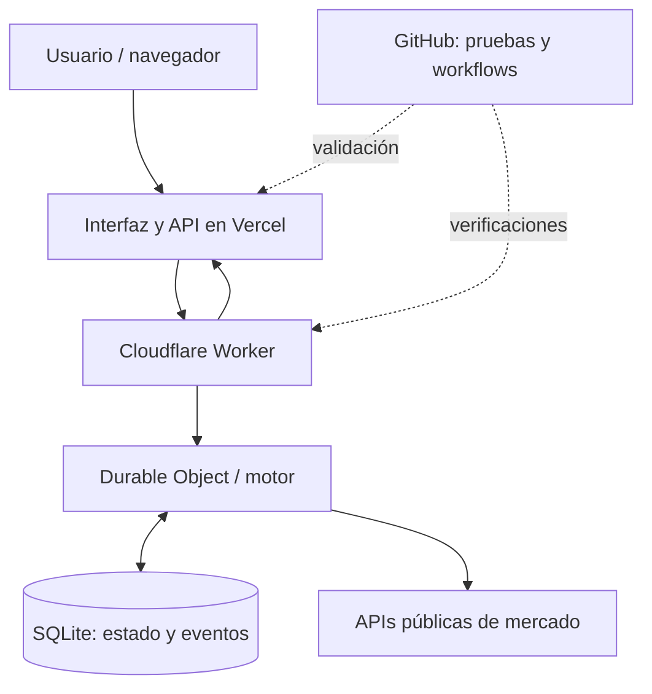

# Arquitectura y evolución operativa — MTF Live Monitor

**Caso de ingeniería personal** orientado a explicar decisiones de arquitectura, confiabilidad y costos. No certifica rentabilidad de estrategias ni disponibilidad del servicio.

## Motivación

El repositorio documenta una migración desde componentes Supabase hacia un backend basado en **Cloudflare Workers y Durable Objects con SQLite**. La razón, los límites técnicos y los pasos de activación están explicados en [la guía de migración](CLOUDFLARE_MIGRATION.md).

## Diagrama de alto nivel

## Decisiones y controles documentados

- **Separación de responsabilidades:** interfaz/API por un lado, ejecución y persistencia de backend por otro.
- **Control de recursos:** presupuestos de llamadas, cuotas, ciclos de trabajo y límites de datos.
- **Persistencia:** preservación de señales, deduplicación, estados e historial de eventos sujetos a las reglas del proyecto.
- **Calidad y frescura:** políticas explícitas de antigüedad, tiempos máximos y tratamiento de fuentes no disponibles.
- **Evaluación responsable:** estudios fuera de muestra, supuestos de costos y rechazo explícito de estrategias sin evidencia suficiente.
- **Pruebas:** scripts automatizados para integridad, causalidad de confirmaciones y confiabilidad de API bajo casos definidos.

## Material verificable

- [Guía de migración y operación](CLOUDFLARE_MIGRATION.md)
- [Reglas de validación de estrategias](STRATEGY_VALIDATION.md)
- [Análisis de alternativas](STRATEGY_SEARCH_2026-10-17.md)
- [Pruebas automatizadas](../tests/)
- [README principal](../README.md)

## Limitaciones

No se verificó mediante esta documentación una auditoría externa integral, un SLA contractual, una base de datos migrada en todos los ambientes ni una rentabilidad financiera comprobada. Las cuotas de planes gratuitos y la disponibilidad de APIs externas permanecen sujetas a los proveedores.

**Enfoque profesional:** decisión técnica sustentada por costos, continuidad, observabilidad, controles de cambios y criterios de aceptación.
