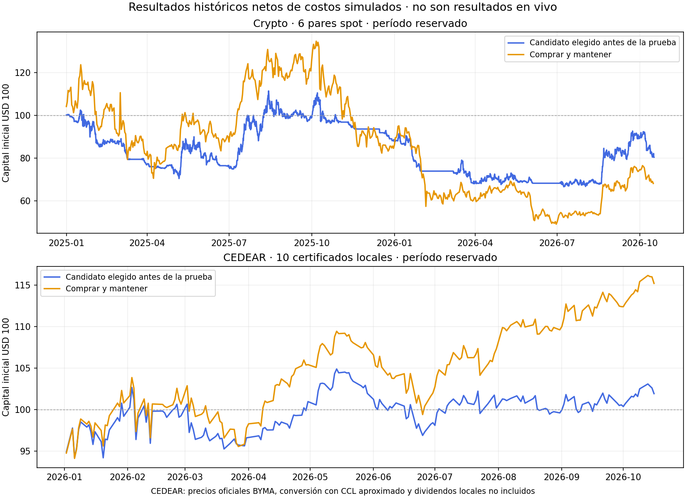

# Comparación de rentabilidad — 17 de octubre de 2026

## Conclusión

No se encontró una estrategia activa que justifique sustituir los motores actuales como una mejora de rentabilidad validada para ambos mercados. Comprar y mantener fue la alternativa con mayor rentabilidad de precios acumulada en validación y prueba final entre las 30 combinaciones predefinidas estudiadas. Eso no garantiza rentabilidad futura: la cartera crypto perdió 31,86% en el período final y llegó a una caída de 63,51% desde su máximo.

Para CEDEAR, la evidencia favorece reducir la rotación y mantener una cartera diversificada, antes que forzar señales intradía con comisiones altas. Para crypto no hay un ganador activo estable: el candidato con mejor entrenamiento perdió 19,61% fuera de muestra. Un modelo distinto de recuperación RSI ganó 11,43% en esa ventana, pero no ganó la selección previa y su validación anterior fue negativa. Promoverlo después de mirar el resultado sería una selección retrospectiva.

No se activan nuevas reglas con estos resultados. Las señales históricas y las estrategias congeladas permanecen intactas. El objetivo de una sustitución activa rentable sigue pendiente de evidencia independiente suficiente.

## Resultados principales

Retornos de cartera en USD después de comisiones y deslizamiento simulados, sin apalancamiento ni impuestos personales. CEDEAR excluye dividendos locales no verificados y usa un CCL aproximado; los porcentajes son de precios, no recibos de rentabilidad real de un cliente.

| Mercado / período | Candidato activo elegido con entrenamiento | Comprar y mantener |
| --- | ---: | ---: |
| Crypto: validación 2023–2024 | +85,85% | +271,51% |
| Crypto: prueba final 1/1/2025–16/10/2026 | **−19,61%** | −31,86% |
| Crypto: validación + final, compuesto | +49,41% | **+153,15%** |
| CEDEAR: validación 1/7/2025–31/12/2025 | +4,06% | +16,57% |
| CEDEAR: prueba final 2/1/2026–16/10/2026 | +1,92% | **+15,18%** |
| CEDEAR: validación + final, compuesto | +6,06% | **+34,27%** |

Al duplicar comisiones y deslizamiento, el candidato activo crypto perdió 35,47% en la prueba final y el activo CEDEAR perdió 2,92%. Comprar y mantener CEDEAR conservó +13,35% en esa sensibilidad.



El candidato activo crypto fue momentum de 180 barras H4 — aproximadamente 30 días —; el activo CEDEAR, momentum de 180 sesiones diarias. El preferido CEDEAR de la selección previa ya era comprar y mantener. La selección activa CEDEAR se incluye como control comparativo: su entrenamiento fue negativo y no es una recomendación.

## Datos y control de errores

- Crypto: BTC, ETH, BNB, XRP, ADA y LTC, spot USDT; históricos diarios y H4 de Binance desde 2017/2018, hasta el 16 de octubre de 2026.
- CEDEAR: AAPL, MSFT, AMZN, GOOGL, META, NVDA, KO, XOM, JNJ y WMT. Operaciones simuladas con OHLC oficiales de BYMA, no con el precio estadounidense como sustituto del certificado.
- Yahoo local contenía cambios de ratio sin ajustar: aproximadamente −49% AAPL en enero de 2024, −66% MSFT en noviembre de 2022 y −75% NVDA en julio de 2021. Esas series no se usaron para ejecutar el backtest.
- BYMA sólo expuso unos dos años, con 485–486 sesiones por activo. Se ajustaron las ventanas CEDEAR por disponibilidad, antes de calcular retornos de estrategias. Los indicadores usan el historial más largo del subyacente estadounidense, con su cierre conocido antes de la siguiente apertura local.
- No aparecieron saltos inexplicados mayores de 15% en la relación certificado/subyacente/CCL durante el período oficial utilizado. Este control no reemplaza un registro completo de acciones corporativas.
- CCL aproximado: precio local de GGAL × 10 / precio de su ADR. No es una cotización ejecutable de cambio. La caja CEDEAR queda en pesos y pierde valor en USD cuando sube el CCL; no se supone que cobra interés ni que está dolarizada sin costo.
- Los datos originales, sus hashes, el protocolo, la selección congelada y los resultados están preservados en [el archivo reproducible](../research-data/strategy-search-2026-10-17.tar.gz). El archivo se excluye de Vercel para evitar servir históricos pesados desde la aplicación.

## Comparación y límites

Se compararon comprar y mantener, tendencias EMA, rupturas Donchian, momentum, recuperaciones RSI y bandas de Bollinger: 20 combinaciones crypto (diario/H4) y 10 CEDEAR. Capital inicial igual repartido en subcarteras, sin préstamos entre ellas ni posiciones cortas; una posición por activo. Las ganancias pueden concentrar una subcartera con el tiempo: no equivale a riesgo constante ni a una asignación personalizada.

Las decisiones usan velas cerradas y se ejecutan en la siguiente apertura disponible. Stops iniciales a tres ATR, con ejecución al precio de apertura cuando hay gap adverso. El cierre final de cada ventana incluye costos y se distingue de una salida natural. Crypto supone por ejecución 0,10% de comisión y 0,05% de deslizamiento; CEDEAR 0,60% y 0,20%. Se repite con ambos costos duplicados. Son supuestos de estudio; faltan tarifas reales del broker, dividendos/custodia locales, impuestos y comprobación de ejecución manual intradiaria.

Crypto entrenó en 2019–2022, validó en 2023–2024 y probó en 2025–16/10/2026. CEDEAR entrenó en 17/10/2024–30/6/2025, validó en el segundo semestre de 2025 y probó en 2026. Se guardaron cambios metodológicos previos a abrir la prueba final. La selección congelada separa el candidato activo del benchmark y registra hashes de datos y código. El torneo completo se ejecutó después como diagnóstico retrospectivo: su ranking no constituye una nueva prueba independiente ni autoriza elegir parámetros mirando el período final.

La búsqueda cubre un conjunto fijo de activos supervivientes y familias limitadas. No demuestra una estrategia universalmente óptima ni una ganancia futura. La pérdida del candidato seleccionado y la sensibilidad a costos impiden presentarlo como reemplazo confiable.

## Reproducir

Con Node 24, extraer el archivo de datos fuera del checkout y copiar únicamente `raw/`, `protocol.json` y `data-manifest.json` a un directorio de reproducción nuevo, para conservar los resultados congelados originales:

```sh
node scripts/search-profitable-strategies.cjs /ruta/reproduccion development
node scripts/search-profitable-strategies.cjs /ruta/reproduccion final
node scripts/audit-strategy-tournament.cjs /ruta/reproduccion
```

Para una nueva descarga del mismo experimento fechado, preparar `protocol.json` desde [el protocolo guardado](research/protocol-2026-10-17.json) y ejecutar `npm run research:fetch -- /ruta/nuevo-estudio`. Los proveedores pueden revisar históricos y BYMA elimina sesiones antiguas: una descarga posterior no sustituye al archivo original.

Los [resultados estructurados](research/results-2026-10-17.json) y el [ranking CSV](research/rankings-2026-10-17.csv) conservan todas las alternativas, incluso las pérdidas. `npm test` verifica causalidad, costos, gaps, monedas y alineación de aperturas locales; esas pruebas verifican el simulador, no acreditan rentabilidad de una estrategia.
